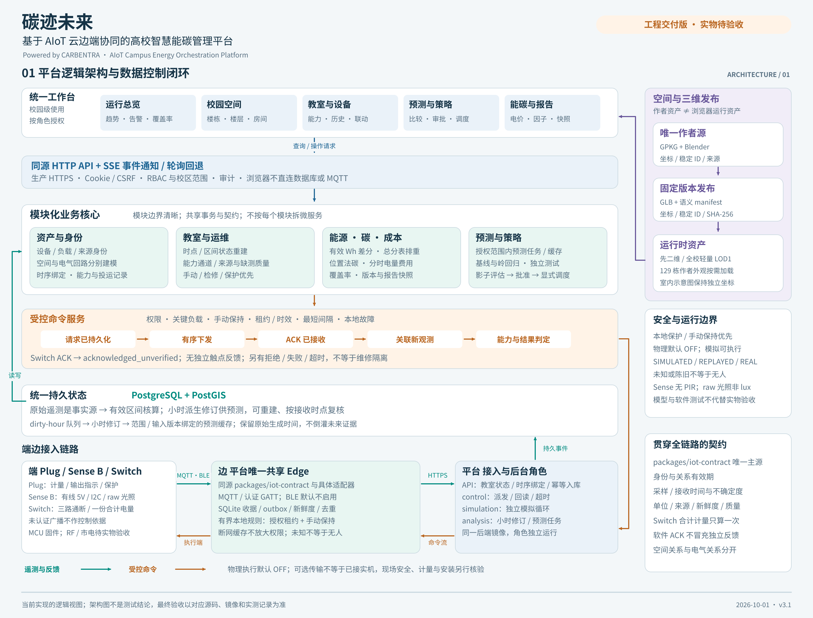
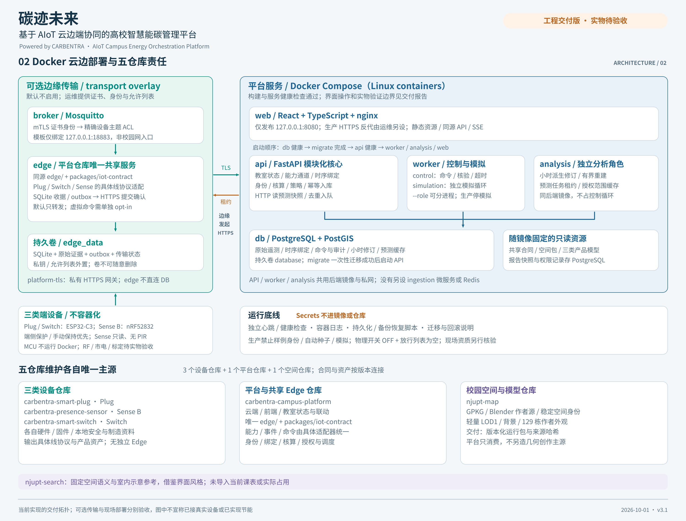
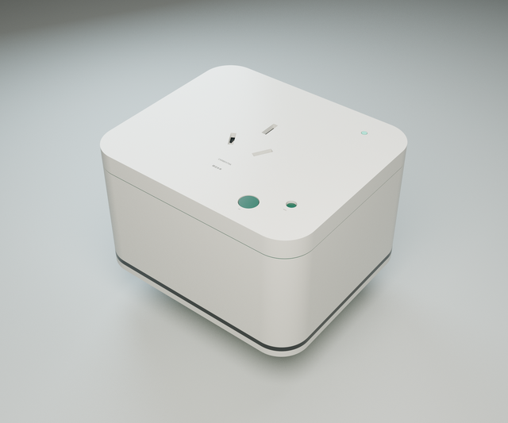
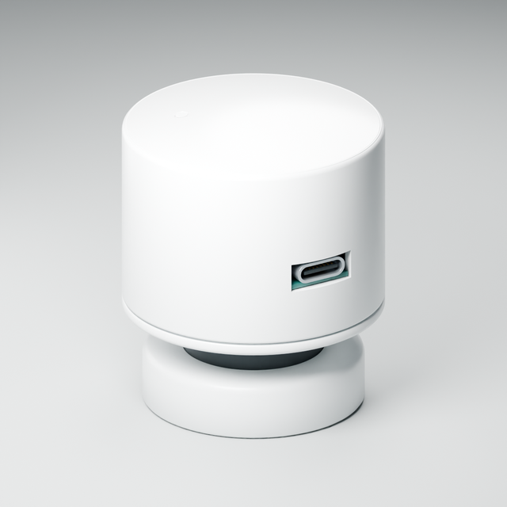
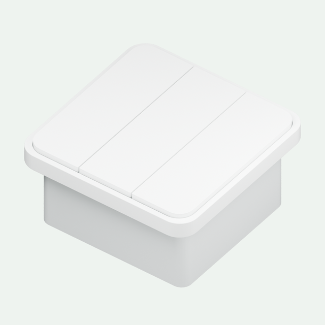
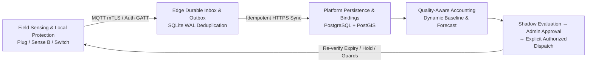

<div align="center">

# CARBENTRA Campus · 碳迹未来

**Spatial-Temporal AIoT Cloud-Edge-End Campus Energy & Carbon Orchestration Platform**  
*3D Spatial & Electrical Topology · Independent Energy/Carbon Accounting · Shadow Policy Evaluation · Controlled Edge Dispatch*

[](https://github.com/hicancan/carbentra-campus-platform/actions/workflows/verify.yml)
[](./pyproject.toml)
[](./compose.yaml)
[](./frontend/package.json)
[](./edge/README.md)
[](./packages/spatial/README.md)
[](./docs/DOCKER_VERIFICATION.md)
[](./LICENSES.md)

[简体中文](./README.md) · **English**

[**Architecture & Invariants**](docs/ARCHITECTURE.md) · [**User & Developer Guide**](docs/USER_GUIDE.md) · [**API Contract**](docs/API_CONTRACT.md) · [**Shared IoT Contract**](packages/iot-contract/README.md) · [**Operations & Handover**](docs/OPERATIONS.md) · [**Docker Verification**](docs/DOCKER_VERIFICATION.md) · [**Companion Platform: StuDev**](https://github.com/NJUPT-CS-StuDev/studev)

</div>

---

**CARBENTRA Campus** is an **AIoT cloud-edge-end campus energy and carbon orchestration platform** that connects **3D campus geometry, electrical metering boundaries, edge telemetry, academic timetable constraints, and auditable control policies** under one rigorous domain model. Together with the student-facing digital campus platform [**StuDev (`NJUPT-CS-StuDev/studev`)**](https://github.com/NJUPT-CS-StuDev/studev), it forms the core engineering implementation of *"Carbon to the Fullest — AI-Driven Zero-Carbon Campus Energy Management System"*, a finalist flagship project in the 28th NJUPT "Innovation Cup" Extracurricular Academic and Technological Competition:

> **Why do an AIoT Energy Platform and a Digital Campus Platform evolve together?**  
> Lighting, HVAC, and plug loads in academic buildings account for the bulk of university carbon emissions—and the primary variable governing room-by-room energy demand is the live academic schedule, maintenance calendar, and real occupancy state. Built around a shared **3D campus spatial package (3 campuses, 136 building entries, 129 3D building models, and 603 spatial units) and semester timeline**, our open-source ecosystem operates in two complementary modes:
> - **For Students & Faculty ([`NJUPT-CS-StuDev/studev`](https://github.com/NJUPT-CS-StuDev/studev))**: Delivers zero-login timetable lookup, real-time 3D free-classroom discovery, and indoor/outdoor pedestrian routing;
> - **For Campus Energy Accounting & Cloud-Edge Control (`carbentra-campus-platform`, this repository)**: Unifies spatial hierarchy, parent-child electrical circuits, timetable/maintenance constraints, edge gateways, and three custom hardware families behind one scoped HTTP API to perform **spatial navigation, temporal device binding, independent energy/carbon/cost accounting, dynamic baselining, shadow policy evaluation, approval workflows, and end-to-end command verification**.

<table>
  <tr>
    <td width="50%">
      <a href="./docs/architecture/01_platform_logical_architecture.png">
        
      </a>
      <p align="center"><sub><b>01 Platform Logical Architecture & Control Loop</b>: Unified workbench, modular domain core, guarded command pipeline, and PostgreSQL+PostGIS persistence</sub></p>
    </td>
    <td width="50%">
      <a href="./docs/architecture/02_docker_deployment_repo_ownership.png">
        
      </a>
      <p align="center"><sub><b>02 Docker Cloud-Edge Topology & Five-Repository Ownership</b>: Least-privilege container isolation, opt-in mTLS transport, and single-source-of-truth repo boundaries</sub></p>
    </td>
  </tr>
</table>

<table>
  <tr>
    <td width="33.3%">
      
      <p align="center"><sub><b><a href="https://github.com/hicancan/carbentra-smart-plug">CARBENTRA Plug</a></b><br/>Plug-load metering, energized output feedback, and local thermal interlock</sub></p>
    </td>
    <td width="33.3%">
      
      <p align="center"><sub><b><a href="https://github.com/hicancan/carbentra-presence-sensor">CARBENTRA Sense B</a></b><br/>Wired 5 V XM125 mmWave radar presence detection and raw ambient light ADC</sub></p>
    </td>
    <td width="33.3%">
      
      <p align="center"><sub><b><a href="https://github.com/hicancan/carbentra-smart-switch">CARBENTRA Switch</a></b><br/>3-channel lighting control, 15-minute local manual hold, and aggregate metering</sub></p>
    </td>
  </tr>
</table>

---

## Why CARBENTRA Campus?

Conventional campus energy dashboards either stop at passive meter visualization or issue naive remote commands detached from field constraints—conflating spatial containment with electrical topology, overwriting historical energy attribution when devices move, or treating missing sensor packets as "zero power / room vacant" and triggering unsafe shutoffs.

CARBENTRA Campus is built from first principles around **eight auditable domain objects** and a **two-phase durable cloud-edge-end loop**:

### Core Domain Ontology

1. **Space**: Four-level hierarchy (`Campus → Building → Floor → Room`) answering *"Where is it?"* Indoor schematic coordinates and outdoor metric GIS coordinates remain distinct without fabricated alignment.
2. **Circuit**: Parent-child electrical distribution topology and metering boundaries answering *"Where does power flow, and which sub-meters are covered by a main meter?"* Spatial containment never implies electrical containment.
3. **Device & Channel**: Devices keep immutable identities across display-name changes; each capability endpoint (`device_id + channel_id`) exposes explicit observation and actuation semantics. UI cards never render unsupported controls.
4. **Temporal Binding**: Maps a device to a space and electrical circuit over a bounded time interval. Moving a device appends a new binding interval and revokes prior control authorization without rewriting yesterday's energy attribution.
5. **Immutable Observation**: Records boot epoch, sequence number, `observed_at`, `received_at`, physical unit, quality, and explicit source provenance (`SIMULATED` / `REPLAYED` / `REAL`). Late or duplicate packets are deduplicated idempotently.
6. **Schedule & RoomMode**: Explicitly models class schedules, maintenance windows, and time-bounded room modes (`Auto`, `Manual Hold`, `Maintenance`). Scheduled classes do not prove physical occupancy, and an unscheduled slot never proves vacancy.
7. **Guarded Command**: Represents an actuation intent carrying target channel, expiry, sequence, authority, and lifecycle evidence. Transport delivery (`PUBACK`) is never conflated with physical actuation; switches without independent contact feedback cap at `acknowledged_unverified`.
8. **Accounting & Forecast**: Derives energy (`kWh`), cost, and carbon emissions from valid cumulative `Wh` deltas with explicit coverage ratios and tariff/factor versions; background `analysis` workers compute explainable forecasts and dynamic baselines without polluting raw telemetry.

### End-to-End Cloud-Edge-End Control Loop



---

## Eight Strict Engineering Invariants

1. **Unknown or Stale Is Never Zero or Vacant**: Missing, expired, unauthenticated, or unbound intervals remain explicitly `unknown`. Multi-sensor occupancy fusion requires all required sensors to be fresh and available before concluding vacancy.
2. **Source Provenance Persists End-to-End**: `SIMULATED`, `REPLAYED`, `REAL`, and `REFERENCE` labels are preserved across storage, UI views, forecasts, and exported reports.
3. **Zero Parent-Child Meter Double Counting**: Metering balance separates parent meters, covered sub-meters, and uncovered residuals. Switch's three relay channels share a single `meter.aggregate` boundary that is never multiplied into three fake channel meters.
4. **Valid Cumulative `Wh` Delta Accounting**: Period energy is computed strictly from valid cumulative `Wh` deltas, excluding boot resets, counter rollbacks, binding transitions, and bad-quality gaps without synthetic interpolation.
5. **Independent Energy, Cost & Carbon Calculation**: Time-of-use tariffs (evaluated in IANA calendar timezones) and location-based carbon factors carry explicit effective dates and provenance.
6. **Pervasive RBAC & Campus Scoping**: `viewer`, `analyst`, `operator`, and `admin` roles combined with campus scopes govern lists, item details, exports, historical reports, and live SSE streams.
7. **Local Hardware Protection Has Final Authority**: Over-temperature interlocks, over-current trips, power-on release, and 15-minute local button holds execute directly on the MCU; cloud policies cannot override local protection, and physical dispatch ships disabled by default (`CARBENTRA_PHYSICAL_DISPATCH_ENABLED=false`).
8. **Single Authoritative Sources & Hash Pinning**: Campus geometry is authored solely in `njupt-map`; wire protocols live in each hardware repository; cross-product capability and event contracts are defined solely in `packages/iot-contract` with SHA-256 verification.

---

## Five-Repository Ecosystem & Companion Platform

| Repository | Sole Authority & Responsibility | Delivered Interfaces & Artifacts |
| :--- | :--- | :--- |
| **[`carbentra-campus-platform`](https://github.com/hicancan/carbentra-campus-platform)**<br/>(This Repository) | Cloud backend, React 3D workbench, identity & temporal bindings, room state reconstruction, accounting, forecasting, **and sole multi-device Edge & IoT contract authority** | Same-origin HTTP API + SSE, `packages/iot-contract`, `edge/`, OpenAPI schema, policy & audit reports |
| **[`carbentra-smart-plug`](https://github.com/hicancan/carbentra-smart-plug)** | ESP32-C3 smart outlet hardware (KiCad 10 / FreeCAD), firmware, metering, energized output feedback, and C local thermal/current protection state machine | Plug wire protocol, capability descriptor, telemetry/feedback frames, and hardware release bundle |
| **[`carbentra-presence-sensor`](https://github.com/hicancan/carbentra-presence-sensor)** | Sense B wired 5 V presence node (nRF52832 + XM125 mmWave radar I2C + TEMT6000 raw light ADC) hardware and Zephyr firmware | Diagnostic BLE advertisements, per-device HMAC challenge-response GATT, freshness/quality observations, and ECAD/MCAD assets |
| **[`carbentra-smart-switch`](https://github.com/hicancan/carbentra-smart-switch)** | 3-channel smart lighting switch (ESP32-C3 + MCP39F511A metering) hardware, firmware, 15-minute local manual hold, and protection guards | 3-channel relay commands, `acknowledged_unverified` receipts, single `meter.aggregate` boundary, and engineering assets |
| **`njupt-map`** | Authoritative 2D GIS and Blender 129-building 3D campus geometry source | Versioned runtime spatial package with stable IDs, coordinates, attribution, and SHA-256 manifests |
| **[`NJUPT-CS-StuDev/studev`](https://github.com/NJUPT-CS-StuDev/studev)**<br/>(Companion Digital Campus) | Student-facing local-first timetables, exams, real-time 3D free-classroom lookup, indoor/outdoor pedestrian routing, and club portal | Shares the 3D campus building assets and 20-week academic schedule spatial-temporal model |

---

## Tech Stack & Verification Baseline

| Layer | Stack | Verification Summary ([`docs/DOCKER_VERIFICATION.md`](docs/DOCKER_VERIFICATION.md)) |
| :--- | :--- | :--- |
| **Backend & Workers** | Python 3.12 · FastAPI · SQLAlchemy 2 · Pydantic 2 · Alembic | **413 passed** across domain accounting, meter balance, temporal bindings, RBAC scoping, anomaly episodes, and migrations |
| **Spatial Database** | PostgreSQL 17 · PostGIS 3.6 | Verified cold start, non-overlapping temporal constraints, and `pg_dump` → `pg_restore` across 2,489 devices |
| **3D Web Workbench** | React 19 · TypeScript 5.9 · Vite 7 · Three.js · TanStack Query | **39 test suites / 200 passed**, OpenAPI type generation check, zero `npm audit` vulnerabilities, and **9 real-browser Playwright acceptance groups** |
| **Edge Gateway** | Python 3.12 · SQLite WAL · Paho MQTT (mTLS) · Bleak · C Verifiers | **72 passed** on Windows + MSVC C startup/time/cert binaries; **70 passed** on Linux container (including POSIX key-permission gates) |
| **Container Hardening** | Docker Compose · Nginx · TLS 1.2/1.3 · Read-Only Rootfs | 8 healthy long-running services with `read_only: true`, `cap_drop: [ALL]`, mTLS broker ACLs, and isolated public demo (`compose.public-demo.yaml`) |

---

## Quick Start & Local Verification

### 1. Launch the Full Campus Simulation Workbench via Docker

Install Docker Desktop (Linux containers) or Docker Engine + Compose, then run from the repository root using PowerShell 7 (`pwsh`):

```powershell
# Build images, run migrations, and seed the v3 603-room SIMULATED campus dataset
.\tools\start-dev.ps1
```

Open **`http://localhost:8080`** (bound strictly to loopback `127.0.0.1:8080`):

- **Development Accounts**: `admin` / `development-only` (plus `operator`, `analyst`, and `viewer` with the same password to inspect RBAC boundaries).
- **Safety Default**: Physical actuation is disabled by default, and all seeded devices and measurements are explicitly labeled `SIMULATED`. See the [User & Developer Guide](docs/USER_GUIDE.md) for a step-by-step walkthrough.

### 2. Local Toolchain & Full Verification Suite

Requires Python `3.12` (managed via `uv`) and Node.js `24.x`:

```powershell
# 1. Create virtual environment and sync locked dependencies
uv venv --python 3.12 .venv
uv sync --locked --all-groups

# 2. Run frontend typechecks, unit tests, and production build
npm --prefix frontend ci
npm --prefix frontend test
npm --prefix frontend run build

# 3. Execute the full local verification suite (PostGIS, backend, Edge, and packaging contracts)
pwsh -File tools/verify-local.ps1 -OutputDirectory D:/Temp/carbentra-check
```

---

## Documentation Index & Operational Boundaries

- [**Architecture & Invariants (`docs/ARCHITECTURE.md`)**](docs/ARCHITECTURE.md) · [**Architecture Diagrams (`docs/architecture/README.md`)**](docs/architecture/README.md)
- [**API Contract (`docs/API_CONTRACT.md`)**](docs/API_CONTRACT.md) · [**Shared IoT Contract (`packages/iot-contract/README.md`)**](packages/iot-contract/README.md) · [**Unified Edge (`edge/README.md`)**](edge/README.md)
- [**Spatial Package (`packages/spatial/README.md`)**](packages/spatial/README.md) · [**Operations & Production Handover (`docs/OPERATIONS.md`)**](docs/OPERATIONS.md)
- [**Isolated Public Simulation (`docs/PUBLIC_DEMO.md`)**](docs/PUBLIC_DEMO.md) · [**Five-Repo Local Suite (`docs/LOCAL_SUITE.md`)**](docs/LOCAL_SUITE.md)
- **Operational Boundary & Licensing**: Field deployment requires physical meter calibration, per-device key provisioning, load qualification, 220 V electrical safety certification, and institutional approval; software tests and simulation loops do not substitute for physical commissioning. Licensed by material under **GNU AGPL-3.0-or-later** (code), **CC-BY-4.0** (documentation/diagrams), and **ODbL-1.0** (OSM-derived spatial data); see [`LICENSES.md`](LICENSES.md).
