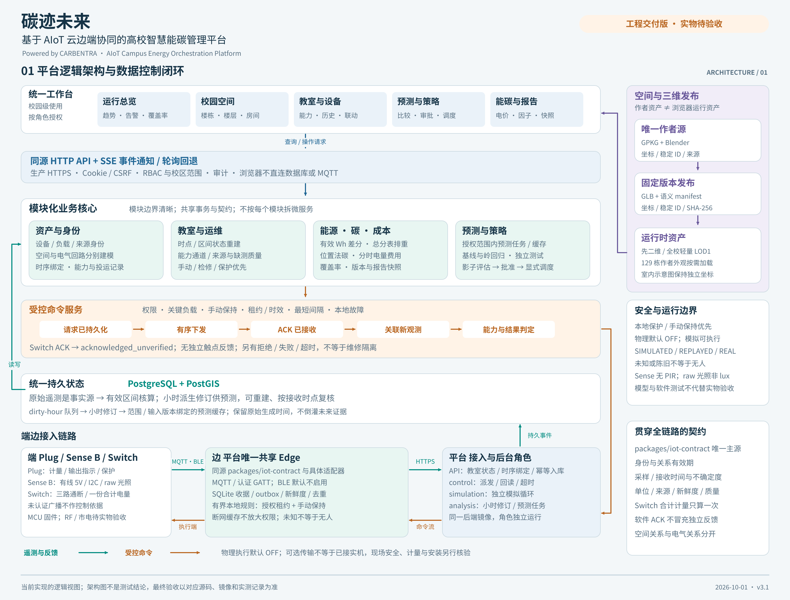
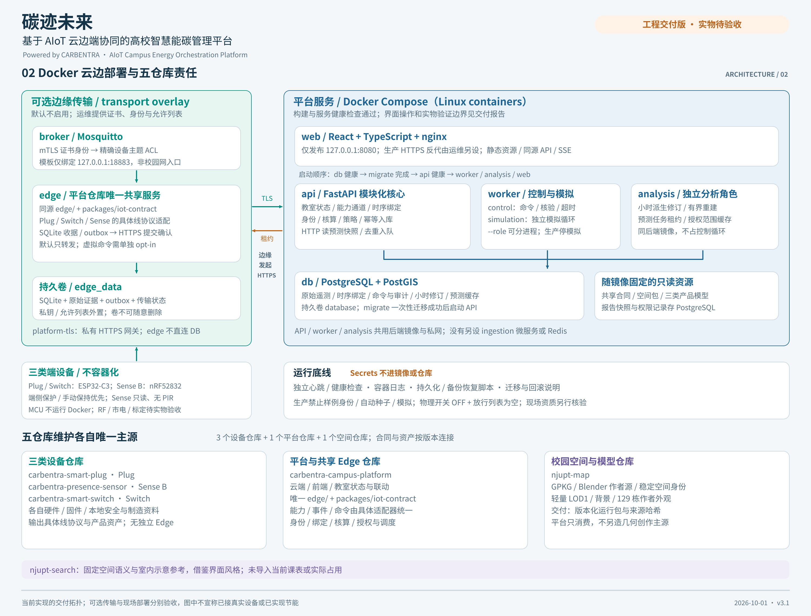
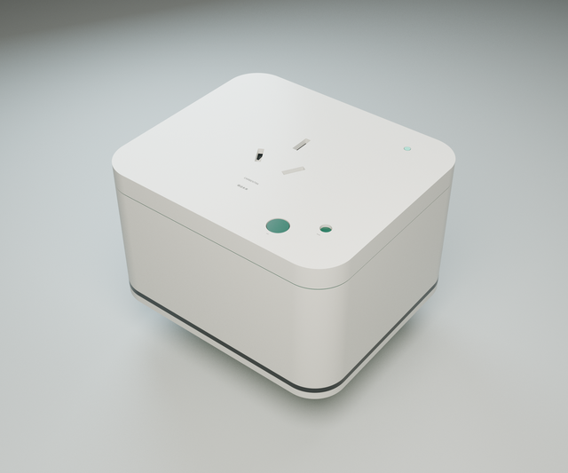
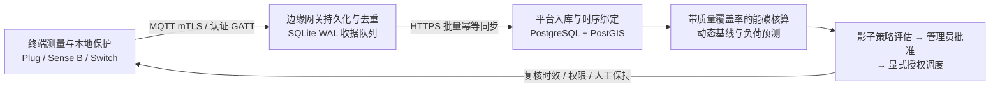

<div align="center">

# 碳迹未来 · CARBENTRA Campus

**时空联动的高校 AIoT 云边端协同智慧能碳管理平台**  
*三维空间与配电拓扑 · 能碳独立核算 · 负荷预测与影子策略 · 受控边缘调度闭环*

[](https://github.com/hicancan/carbentra-campus-platform/actions/workflows/verify.yml)
[](./pyproject.toml)
[](./compose.yaml)
[](./frontend/package.json)
[](./edge/README.md)
[](./packages/spatial/README.md)
[](./docs/DOCKER_VERIFICATION.md)
[](./LICENSES.md)

**简体中文** · [English](./README.en.md)

[**架构与核心规则**](docs/ARCHITECTURE.md) · [**使用与开发交接指南**](docs/USER_GUIDE.md) · [**API 契约**](docs/API_CONTRACT.md) · [**共享 IoT 合同**](packages/iot-contract/README.md) · [**运行与生产交接**](docs/OPERATIONS.md) · [**Docker 验证记录**](docs/DOCKER_VERIFICATION.md) · [**姊妹平台 StuDev**](https://github.com/NJUPT-CS-StuDev/studev)

</div>

---

**碳迹未来 · CARBENTRA Campus** 是面向高校园区的 **AIoT 云边端协同智慧能碳管理平台**，把**校园三维空间、配电计量边界、边缘终端遥测、教学排课约束与可执行节能策略**连接在同一套严密的工程模型中。本项目与面向全校师生的数字校园开源平台 [**StuDev（`NJUPT-CS-StuDev/studev`）**](https://github.com/NJUPT-CS-StuDev/studev) 共同构成南京邮电大学第二十八届“创新杯”大学生课外学术科技作品竞赛终审决赛重点培育项目 **《碳尽其用——AI驱动的零碳园区碳能管控系统》** 的核心工程实现：

> **为什么智慧能碳平台与数字校园平台共生演进？**  
> 高校教学楼与公共场馆的照明、空调及插接负载占校园建筑碳排放的大头，而决定每个房间用能需求的根本变量正是全校的教学排课、维护计划与真实在室状态。我们围绕同一套**校园三维空间包（3 校区、136 个建筑登记项、129 栋三维建筑模型、603 个空间单元）与教学时间轴**构建了双模态开源体系：
> - **面向全校师生日常服务（[`NJUPT-CS-StuDev/studev`](https://github.com/NJUPT-CS-StuDev/studev)）**：提供零门槛、免登录的课表考务、三维教学楼空教室查询与室内外步行导航；
> - **面向园区能碳核算与云边协同调度（本仓库 `carbentra-campus-platform`）**：将校园空间拓扑、电气父子回路、排课与检修约束同边缘网关及三类自研硬件终端打通，通过同一组受控 API 完成**全校空间浏览、设备时序绑定、能碳独立核算、动态基线与负荷预测、影子策略评估、审批放行及端到端命令结果追踪**。

<table>
  <tr>
    <td width="50%">
      <a href="./docs/architecture/01_platform_logical_architecture.png">
        
      </a>
      <p align="center"><sub><b>01 平台逻辑架构与数据控制闭环</b>：统一工作台、模块化业务核心、受控命令链路与云边端持久状态</sub></p>
    </td>
    <td width="50%">
      <a href="./docs/architecture/02_docker_deployment_repo_ownership.png">
        
      </a>
      <p align="center"><sub><b>02 Docker 云边部署与五仓库责任边界</b>：容器最小权限隔离、可选 mTLS 传输层与五仓库唯一主源分工</sub></p>
    </td>
  </tr>
</table>

<table>
  <tr>
    <td width="33.3%">
      
      <p align="center"><sub><b><a href="https://github.com/hicancan/carbentra-smart-plug">CARBENTRA Plug</a></b><br/>插接负载计量、输出带电回读与本地热保护</sub></p>
    </td>
    <td width="33.3%">
      
      <p align="center"><sub><b><a href="https://github.com/hicancan/carbentra-presence-sensor">CARBENTRA Sense B</a></b><br/>5 V 有线 XM125 毫米波雷达存在检测与原始光照采样</sub></p>
    </td>
    <td width="33.3%">
      
      <p align="center"><sub><b><a href="https://github.com/hicancan/carbentra-smart-switch">CARBENTRA Switch</a></b><br/>三路普通照明独立控制、本地按键保持与单份合计计量</sub></p>
    </td>
  </tr>
</table>

---

## 为什么构建 CARBENTRA Campus

传统的校园能耗监测系统往往停留在“静态电表大屏”或“脱离现场约束的远程遥控”：既分不清**空间包含关系**与**配电回路关系**，也无法处理传感器断网晚到、设备搬迁历史、排课检修冲突与本地按键接管，甚至把缺测或过期数据当成“零耗电 / 教室无人”直接触发误关停。

CARBENTRA Campus 从工程第一性原理出发，将系统建立在**八类可追溯的核心领域对象**与**一条完整的云边端控制闭环**之上：

### 核心领域模型

1. **空间（Space）**：校区、建筑、楼层、房间四级稳定标识，回答“设备与负载在哪里”。室内平面示意坐标与室外米制地理坐标分别保留，不做缺乏测量依据的虚假配准。
2. **电路（Circuit）**：父子配电拓扑与计量边界，回答“电从哪里来、哪块总表覆盖了哪些分表”。空间包含关系不等于配电从属关系。
3. **设备与通道（Device & Channel）**：设备具备不随显示名改变的稳定身份；单个设备内含独立能力与观测语义的端点（`device_id + channel_id`），无对应硬件能力的通道绝不在界面上渲染虚假操作按钮。
4. **时序绑定（Temporal Binding）**：记录设备在特定时间段内关联的空间与电路。搬迁设备只追加新的绑定区间并自动清除旧控制授权，绝不篡改历史用电归属。
5. **不可变观测（Observation）**：完整保留设备启动纪元、序列号、观测时间（`observed_at`）、接收时间（`received_at`）、单位、质量与来源标签（`SIMULATED` / `REPLAYED` / `REAL`）。晚到与重传事件幂等去重，不产生重复记账。
6. **计划与房间模式（Schedule & RoomMode）**：显式建模排课、检修以及自动、人工保持、维护等带有效期的房间运行模式。计划排课不等于实测有人，无排课也不等于教室空置。
7. **受控命令（Command）**：携带目标通道、有效期、序列号、权限与阶段证据的控制意图。消息送达（PUBACK）不等于执行成功；无独立触点反馈的照明开关最高只标记为 `acknowledged_unverified`。
8. **能碳核算与负荷预测（Accounting & Forecast）**：从有效累计电能差分导出电量、费用与碳排放，保留时间覆盖率、电价与碳因子版本；预测任务在独立分析进程运行并保留动态基线比较与不确定度，绝不反过来冒充原始遥测。

### 云边端最短控制闭环



- **双阶段持久提交**：边缘网关（`edge/`）将设备事件写入本地 SQLite WAL 后才向终端确认接收；平台 PostgreSQL 事务落盘后，边缘才推进同步游标，断网恢复后不丢账、不重算。
- **评估、批准与调度三权分立**：策略必须先在无副作用的影子模式（`SHADOW`）下完成历史与基线评估，经管理员审批后才可发起显式调度；实际下发瞬间再次复核权限、租约时效、人工保持（如现场按键触发的 15 分钟人工接管）与关键负载约束。

---

## 八条严格工程不变量

平台通过类型系统、PostgreSQL 约束、状态机与 680 余项自动化测试强制保障以下规则始终成立：

1. **未知与过期绝不等于零或无人**：缺测、陈旧、未认证或未完成绑定的数据区间严格保持“未知”状态；多传感器占用融合中，“任一新鲜有人”即可形成有人证据，而“判定无人”要求所有必需感知点同时新鲜且可用，绝不用缺测投票触发断电。
2. **数据来源全链路显式保留**：`SIMULATED`（模拟生成）、`REPLAYED`（历史回放）、`REAL`（真实接入）与 `REFERENCE`（工程参考）在数据库存储、前端看板、负荷预测与报表导出中全程透传，绝不混淆模拟演示与真实现场。
3. **总分表严禁重复累加**：计量平衡分别核算父级总表、子级分表与未覆盖残差；同一时段绝不把父级总表与其已覆盖的下级分表相加。Switch 三路继电器共享的 `meter.aggregate` 合计电量只计一次，绝不虚构三份单路电量。
4. **累计 Wh 有效差分核算**：期间电量严格按有效累计 `Wh` 差分换算为 `kWh`，自动剔除跨重启纪元、计数回退、跨绑定变更与质量异常区间，不作虚假插值补齐。
5. **电量、电费与碳排独立核算**：分时电价（按 IANA 日历时区解析峰谷时段）与位置法碳排放因子各自绑定生效版本与来源，历史重算不篡改早期已冻结的报告快照。
6. **RBAC 与校区边界全接口穿透**：`viewer`、`analyst`、`operator`、`admin` 四级角色与授权校区范围同时约束列表查询、单项详情、历史曲线、报表导出与 SSE 实时事件流。
7. **终端本地保护拥有最高否决权**：过温闭锁、过流保护、上电默认释放与现场物理按键保持在 MCU 固件端直接生效；云端算法与边缘网关无权绕过本地硬件保护，且平台交付默认关闭一切物理继电器吸合（`CARBENTRA_PHYSICAL_DISPATCH_ENABLED=false`）。
8. **单一事实主源与哈希锁定**：校园空间几何只在 `njupt-map` 创作；设备原生线协议由各硬件仓库维护；跨设备统一能力与事件契约唯一由本仓库 `packages/iot-contract` 定义，所有跨仓消费产物均附带版本与 SHA-256 校验。

---

## 系统功能与空间资产规模

### 核心业务工作台（13 个前端路由全覆盖）

- **全校运行总览**：按授权校区实时聚合在线覆盖率、数据来源构成、活跃异常工单与近期能碳趋势。
- **二维/三维校园空间与楼层教室矩阵**：支持按校区、楼栋、楼层、房间四级下钻；先加载全校轻量 LOD1 模型，按需加载 129 栋精细建筑外观与教室设备矩阵；支持无室内平面图时的完整结构化房间清单回退。
- **教室状态重构与双切面查询**：同一套状态重建函数同时支持“固定教室查时间轴历史”与“固定时刻查全校教室空间快照”，分层展示排课计划、感知证据、通道状态与下发命令。
- **设备、配电拓扑与三维产品拆解**：管理设备时序空间绑定与父子配电回路；内置 Plug、Sense B、Switch 固定版本 GLB 三维硬件参考模型，支持按稳定零件 ID 聚焦、拆解与 SHA-256 来源核验。
- **能耗分析、分时电费与碳排核算**：提供计量平衡核对、有效覆盖率分母说明、分时电价与碳因子版本管理。
- **负荷预测、影子策略评估与受控调度**：后台独立 `analysis` 角色执行可解释统计预测与动态基线对比；支持影子策略创建、评估冻结、管理员审批、模拟调度与命令全生命周期追踪。
- **告警工单、排课检修约束与审计报表**：持续异常自动聚合为单条 `AnomalyEpisode`（含首末时间、基线阈值与证据覆盖率，重复扫描不刷屏）；支持带完整来源元数据的 JSON / CSV 报表快照导出与会话级安全审计。

### 校园空间包与演示种子说明

当前随仓库锁定的空间包覆盖 **3 个来源校区、136 个建筑登记项、603 个空间单元**（其中 **129 栋建筑**具备三维地图模型）。在本地开发模式下，v3 确定性种子在这 603 个空间单元上生成教室场景与 **4,221 个设备能力通道**，所有模拟设备、观测与能耗数据均显式标记为 `SIMULATED`。生产部署默认不导入任何开发种子，且物理控制默认关闭。

---

## 五仓库硬件与空间生态协同

CARBENTRA 采用五仓库解耦协同架构，并与面向师生的 [**StuDev 数字校园平台**](https://github.com/NJUPT-CS-StuDev/studev) 共享校园三维空间基准：

| 仓库 | 核心职责与唯一主源 | 对外交付接口与契约 |
| :--- | :--- | :--- |
| **[`carbentra-campus-platform`](https://github.com/hicancan/carbentra-campus-platform)**<br/>（本仓库） | 云端后端、React 三维工作台、身份与时序绑定、教室状态重建、能碳核算与预测调度；**全栈唯一多设备 Edge 与 IoT 合同主源** | 同源 HTTP API + SSE、`packages/iot-contract`、`edge/`、OpenAPI 机器契约、策略与审计报表 |
| **[`carbentra-smart-plug`](https://github.com/hicancan/carbentra-smart-plug)** | ESP32-C3 智能插座硬件（KiCad 10 / FreeCAD）、固件、计量与输出带电反馈、C 语言本地热/过流保护状态机 | Plug 线协议、设备能力描述、遥测/反馈帧与硬件工程发布包 |
| **[`carbentra-presence-sensor`](https://github.com/hicancan/carbentra-presence-sensor)** | Sense B 有线 5 V 存在传感节点（nRF52832 + XM125 毫米波雷达 I2C + TEMT6000 原始光照 ADC）硬件与 Zephyr 固件 | 诊断 BLE 广播、每设备密钥挑战-响应认证 GATT、新鲜度/质量观测与硬件工程资产 |
| **[`carbentra-smart-switch`](https://github.com/hicancan/carbentra-smart-switch)** | 三路普通照明智能开关（ESP32-C3 + MCP39F511A 计量）硬件、固件、本地按键 15 分钟保持与保护守卫 | 三路继电器命令与 `acknowledged_unverified` 回执、单份 `meter.aggregate` 合计计量与工程资产 |
| **`njupt-map`** | 校园二维 GIS 与 Blender 129 栋三维建筑几何创作主源 | 带稳定空间 ID、坐标参考、来源归属与 SHA-256 清单的运行时空间包 |
| **[`NJUPT-CS-StuDev/studev`](https://github.com/NJUPT-CS-StuDev/studev)**<br/>（姊妹数字校园平台） | 面向全校师生的本地优先课表考务、实时空闲自习室查询、室内外三维步行导航与学生发展中心门户 | 共享校园三维建筑资产与全学期教学周历、排课及考务时空推演模型 |

---

## 技术栈与自动化验证门禁

### 技术栈一览

| 层级 | 技术选型 | 关键工程实现 |
| :--- | :--- | :--- |
| **后端与工作进程** | Python 3.12 · FastAPI · SQLAlchemy 2 · Pydantic 2 · Alembic | API、`control` 控制循环、`simulation` 模拟器与 `analysis` 预测训练共用同一加固镜像并按角色进程隔离 |
| **空间与时序数据库** | PostgreSQL 17 · PostGIS 3.6 | 严格外键、时间区间不重叠约束、幂等事件落盘、`pg_dump` / `pg_restore` 真实备份恢复验证 |
| **前端工作台** | React 19 · TypeScript 5.9 · Vite 7 · Three.js · TanStack Query | 从后端 OpenAPI 自动生成强类型前端契约（`api:generate`），三维校园建筑按需加载与硬件 GLB 拆解 |
| **边缘网关（Edge）** | Python 3.12 · SQLite WAL · Paho MQTT (mTLS) · Bleak · Cryptography | 本地持久化收据与发件箱、证书身份绑定 ACL、C 语言启动/时间/证书安全校验器 |
| **容器与生产安全** | Docker Compose · Nginx · TLS 1.2/1.3 · Read-Only Rootfs | 全容器 `read_only: true`、`cap_drop: [ALL]`、`no-new-privileges`、内网隔离与只读公开仿真沙箱（`compose.public-demo.yaml`） |

### 本机与容器实测验证基线（详见 [`docs/DOCKER_VERIFICATION.md`](docs/DOCKER_VERIFICATION.md)）

| 验证维度 | 实测结果摘要 |
| :--- | :--- |
| **Python 后端与 PostGIS 领域测试** | **413 passed**（覆盖能碳差分核算、总分表防重、时序绑定历史、RBAC 校区隔离、异常聚合与预测任务） |
| **Node 24 前端单元与契约测试** | **39 个测试文件 / 200 passed**，`tsc --noEmit`、OpenAPI 类型一致性检查与生产构建全部通过，`npm audit` 0 漏洞 |
| **多平台边缘网关（Edge）测试** | Windows + MSVC C 验证器 **72 passed**；Linux 容器（含 POSIX 私钥权限门禁）**70 passed** |
| **真实 Mosquitto mTLS 断网重连闭环** | 6 台虚拟设备跨 3 产品家族，验证断网积压持久化、重连排空与零命令重放 |
| **Microsoft Edge 真实浏览器端到端验收** | **9 大场景全通过**：登录鉴权、13 个路由渲染、603 教室矩阵、Switch 三路控制与单份合计计量、900 秒人工保持与旁路隔离、SHADOW 零下发评估及 API 重启状态持久化 |
| **生产加固与备份恢复演练** | 8 个长期服务健康检查通过；验证错误 CA/主机名拒绝、HttpOnly/Secure/SameSite 会话、CSRF 防护，以及 2,489 台设备真实 `pg_dump` → `pg_restore` 恢复 |

---

## 仓库目录结构

```text
carbentra-campus-platform/
├── backend/                    # FastAPI 后端、领域模型、能碳核算、负荷预测与 Alembic 迁移
│   ├── app/                    # 路由、教室状态重建、配电拓扑、策略评估、worker 与 analysis 角色
│   └── tests/                  # 后端单元与 PostgreSQL 集成测试套件
├── frontend/                   # React 19 + TypeScript + Three.js 智慧能碳三维工作台
│   ├── src/                    # 13 个业务视图、三维校园地图组件、GLB 硬件拆解器与生成式 API 客户端
│   └── scripts/                # OpenAPI 强类型契约生成与校验脚本
├── edge/                       # 平台唯一多设备边缘网关（MQTT mTLS / 认证 BLE GATT / SQLite WAL 队列）
├── packages/
│   ├── iot-contract/           # 跨仓库唯一权威 IoT 能力、遥测事件与受控命令协议包
│   ├── spatial/                # 锁定的 3 校区 / 129 栋三维建筑 / 603 空间单元运行时数据包与校验测试
│   ├── product/                # Plug / Sense B / Switch 三类硬件 GLB 模型、渲染图与 SHA-256 清单
│   └── contracts/              # OpenAPI 机器契约 (openapi.json)
├── infra/                      # Nginx 反代、Mosquitto mTLS 入口、容器密钥加载器与公开演示网关配置
├── tools/                      # Windows/Linux 统一 PowerShell 7 启动、全量验证、备份恢复与生产演练脚本
├── tests/                      # 跨服务验收测试、容器安全基线测试与 Playwright 真实浏览器验收脚本
├── docs/                       # 架构不变量、使用指南、运维手册、Docker 验证记录与 SVG/PNG 架构图生成器
├── compose.yaml                # 本地开发与仿真 Docker Compose 编排（仅绑定 127.0.0.1:8080）
├── compose.prod.yaml           # 生产环境加固编排（默认禁用开发种子、模拟器与物理继电器吸合）
├── compose.transport.yaml      # 可选的 Mosquitto mTLS 代理与边缘网关容器编排
└── compose.public-demo.yaml    # 强隔离、资源受限的只读公开仿真演示编排
```

---

## 本地快速启动与开发验证

### 1. Docker 一键启动全校仿真工作台

安装 Docker Desktop（启用 Linux containers）或 Docker Engine + Compose，在仓库根目录使用 PowerShell 7（`pwsh`）运行：

```powershell
# 启动完整本地开发栈（构建镜像、执行数据库迁移并导入 v3 全校模拟种子）
.\tools\start-dev.ps1
```

启动完成后在浏览器打开 **`http://localhost:8080`**（服务仅绑定本机回环地址 `127.0.0.1:8080`）：

- **开发测试账户**：用户名 `admin`，密码 `development-only`（另有 `operator`、`analyst`、`viewer` 三个角色账户，密码相同，用于测试不同 RBAC 权限与审批流）。
- **安全默认状态**：顶栏与系统管理页面明确标识“现场实际控制已关闭”，所有样例数据均带 `SIMULATED` 标签。完整浏览路径详见 [《中文使用与开发交接指南》](docs/USER_GUIDE.md)。

### 2. 本机开发环境与全量自动化验证

Python 统一使用 `3.12`（通过根目录 `uv.lock` 锁定跨平台依赖），Node.js 使用 `24.x`：

```powershell
# 1. 创建虚拟环境并同步全部依赖组
uv venv --python 3.12 .venv
uv sync --locked --all-groups

# 2. 安装前端依赖并运行前端测试与构建
npm --prefix frontend ci
npm --prefix frontend test
npm --prefix frontend run build

# 3. 运行本机全套后端、PostGIS、边缘网关与基础设施契约验证
pwsh -File tools/verify-local.ps1 -OutputDirectory D:/Temp/carbentra-check
```

---

## 深入阅读与交付文档导航

- [**架构与核心不变量（`docs/ARCHITECTURE.md`）**](docs/ARCHITECTURE.md)：核心领域对象、双切面查询原理、动态基线与云边端断网恢复语义
- [**架构图与生成器（`docs/architecture/README.md`）**](docs/architecture/README.md)：3000 × 2280 逻辑架构图与部署拓扑图说明及 `create_diagrams.py` 重建方式
- [**API 机器契约（`docs/API_CONTRACT.md`）**](docs/API_CONTRACT.md)：同源 HTTP API 与 `packages/contracts/openapi.json` 规范
- [**共享 IoT 合同（`packages/iot-contract/README.md`）**](packages/iot-contract/README.md) 与 [**统一边缘网关（`edge/README.md`）**](edge/README.md)：三类硬件协议适配、持久传输与授权边界
- [**空间数据包说明（`packages/spatial/README.md`）**](packages/spatial/README.md)：空间稳定 ID、坐标体系、导入校验与重建流程
- [**运行与生产交接手册（`docs/OPERATIONS.md`）**](docs/OPERATIONS.md)：开发、生产 HTTPS、数据库迁移、备份与恢复操作
- [**隔离公开仿真指南（`docs/PUBLIC_DEMO.md`）**](docs/PUBLIC_DEMO.md)：使用 `compose.public-demo.yaml` 部署带独立仿真操作员的只读公开演示环境
- [**五仓本机维护总览（`docs/LOCAL_SUITE.md`）**](docs/LOCAL_SUITE.md) 与 [**参考材料取舍（`docs/REFERENCE_DECISIONS.md`）**](docs/REFERENCE_DECISIONS.md)

---

## 安全运行边界与开源许可

- **工程交付与现场安全边界**：本仓库提供完整的软件平台、边缘网关、协议契约与仿真验证闭环。实际校园强电投运前，仍须由具备资质的专业人员完成现场计量校准、设备密钥注入、负载核定、220 V 电气安全检验与机构审批；软件测试通过、仿真闭环与三维模型不替代实物硬件合格认证或现场实测节能结论。
- **分层开源许可证**：详见 [`LICENSES.md`](LICENSES.md)。原创后端、前端、边缘网关、共享 IoT 合同与测试工具采用 [GNU AGPL-3.0-or-later](LICENSE) 协议开源；原创技术文档与架构图采用 [CC-BY-4.0](LICENSE-DOCUMENTATION) 协议许可；导入的校园空间底图与 OpenStreetMap 派生数据遵循 ODbL-1.0 协议并保留上游署名。
